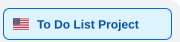

# To-Do List | Descomplica & Venturus

<a href="README.md"><picture><source media="(prefers-color-scheme: dark)" srcset="docs/assets/navigation/project-pt.svg"><source media="(prefers-color-scheme: light)" srcset="docs/assets/navigation/project-pt-light.svg"></picture></a><a href="README.en.md" aria-current="page"><picture><source media="(prefers-color-scheme: dark)" srcset="docs/assets/navigation/project-en-active.svg"><source media="(prefers-color-scheme: light)" srcset="docs/assets/navigation/project-en-active-light.svg"></picture></a> 
<a href="docs/RESPONSABILIDADES.md"><picture><source media="(prefers-color-scheme: dark)" srcset="docs/assets/navigation/team-pt.svg"><source media="(prefers-color-scheme: light)" srcset="docs/assets/navigation/team-pt-light.svg"></picture></a><a href="docs/RESPONSIBILITIES.en.md"><picture><source media="(prefers-color-scheme: dark)" srcset="docs/assets/navigation/team-en.svg"><source media="(prefers-color-scheme: light)" srcset="docs/assets/navigation/team-en-light.svg"></picture></a>

Final project for the **Web Development Fundamentals / Web Programming Logic** learning track, developed collaboratively by **André** and **Paula**.

The project is a task management web application built with **HTML, CSS, and vanilla JavaScript**. It focuses on DOM manipulation, task management, browser storage, accessibility, responsive design, and themed user interfaces.

> **Project status:** In planning and development. The features below describe the agreed scope, not necessarily completed implementations.

## Planned features

- Create, display, edit, complete, and delete tasks (CRUD).
- Persist tasks locally in the browser using `localStorage`.
- Set task priorities and deadlines.
- Search and filter tasks.
- Display progress and task statistics.
- Switch between visual themes and light, dark, or automatic appearance modes.
- Support Portuguese (Brazil) and English.
- Provide responsive and accessible interactions.

## Visual themes

Three visual experiences are planned. Both contributors will implement defined parts of each theme.

| Theme | André | Paula |
| --- | --- | --- |
| **Orbit & Gravity** | Space scenery, stars, sun, and controls | Theme coordination; planets, orbits, positioning, and interactions |
| **Sinking Island** | Theme coordination; tide and task-progress logic | Island, water, scenery, and transitions |
| **Celestial Balance** | Lunar experience | Solar experience |

## Theme Gallery

**Planned visual concepts:** these previews represent the proposed theme designs, not implemented screens. On GitHub, click a thumbnail to open the original image in a new tab while keeping this README open.

### Orbit & Gravity

<table>
  <tr><th>Light mode</th><th>Dark mode</th></tr>
  <tr>
    <td></td>
    <td></td>
  </tr>
</table>

### Sinking Island

<table>
  <tr><th>Light mode</th><th>Dark mode</th></tr>
  <tr>
    <td></td>
    <td></td>
  </tr>
</table>

### Celestial Balance

<table>
  <tr><th>Light mode</th><th>Dark mode</th></tr>
  <tr>
    <td></td>
    <td></td>
  </tr>
</table>

## Team and responsibilities

The responsibilities below reflect the division confirmed by both contributors in their conversation. They describe **implementation ownership**, not exclusive decision-making authority: shared interfaces, data contracts, and integrations are reviewed together.

### Phase 1 — Core application

| André | Paula |
| --- | --- |
| `task-model.js` — create and validate task objects | `storage.js` — data layer with create, read, update, and delete operations |
| `eventos.js` — notify modules when task data changes | Task list rendering |
| Task creation and form | Mark tasks as completed |
| Task editing | |
| Task deletion | |

Paula will propose the task data format in a GitHub Issue. **Both contributors must review and approve the schema and module contracts before implementation.** UI features use the common storage functions, rather than implementing separate persistence logic.

### Phase 2 — Additional features

| André | Paula |
| --- | --- |
| Task statistics and progress indicators | Task priorities |
| Deadlines and urgency rules | Search and filters |
| Page structure and navigation | Theme selector |
| Light, dark, and automatic appearance modes | Language-switching mechanism |

Each contributor translates and tests the features they implement. Accessibility, integration, testing, code review, and project documentation are shared responsibilities.

For the agreed division, integration guidelines, and planned GitHub Issues, see [Responsibilities](docs/RESPONSIBILITIES.en.md) *(draft for joint review)*.

## Technology stack

- HTML5
- CSS3
- JavaScript (vanilla)
- Browser `localStorage`
- Git and GitHub

No framework, external API, or backend is required for the core project.

## Project structure

The repository currently starts from a minimal HTML/CSS/JavaScript structure. Additional modules and theme-specific styles will be created as the work progresses. Names shown in the responsibilities section reflect the planned module contracts.

## Collaboration workflow

1. Define each feature and its acceptance criteria in a GitHub Issue.
2. Implement changes separately, keeping commits focused on one subject.
3. Open a Pull Request (PR) for review by the other contributor.
4. Verify that the integration works before merging into `main`.
5. Update documentation when an agreed interface or responsibility changes.

## Presentation

The project will be prepared for an approximately **10-minute presentation**, highlighting the working task manager, code organization, and contributions from both developers.

## Contributors

- **André** — development, architecture, UI, and documentation.
- **Paula** — development, data management, UI, and documentation.

Both contributors share responsibility for technical decisions and the final result.
