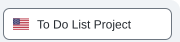
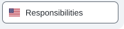
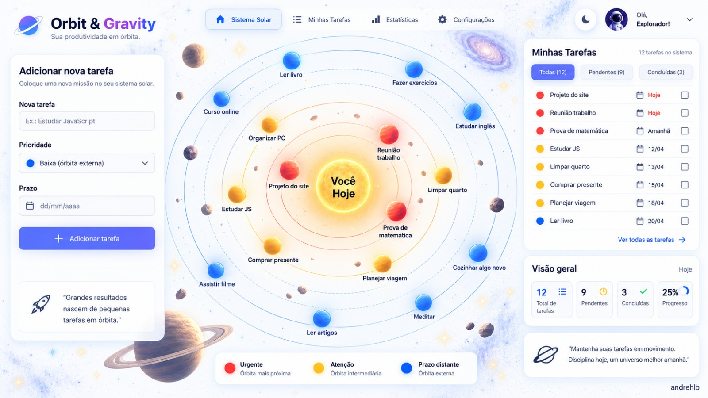
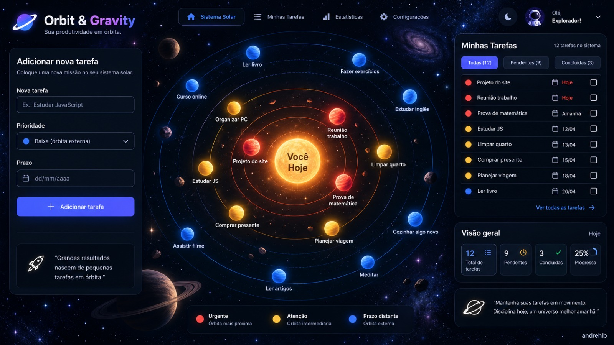
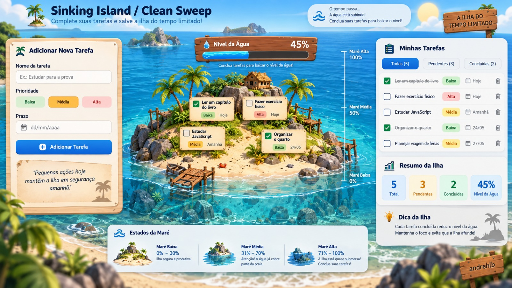
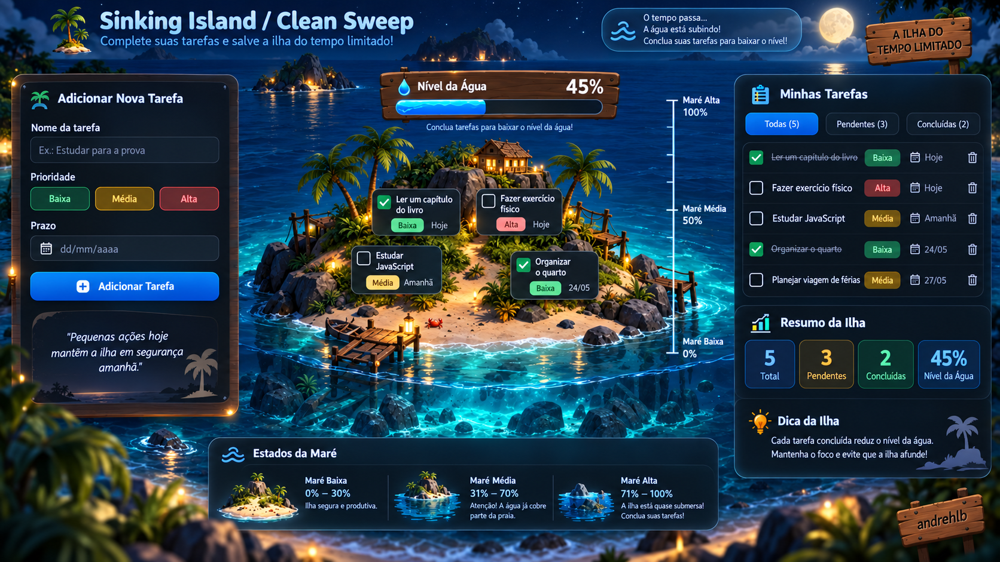
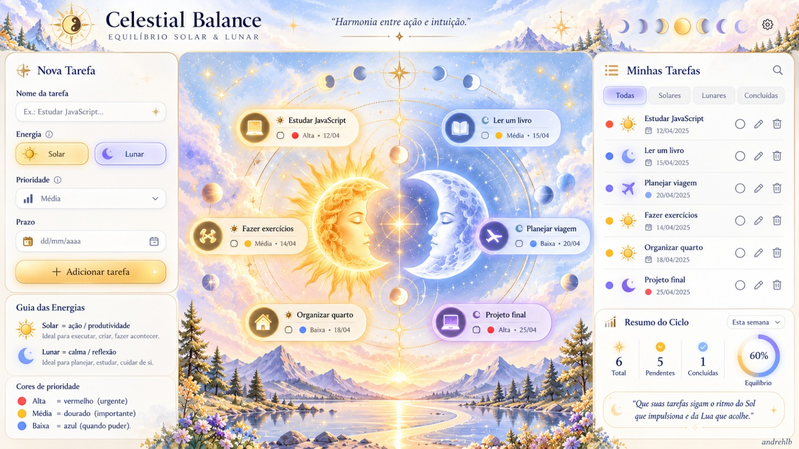
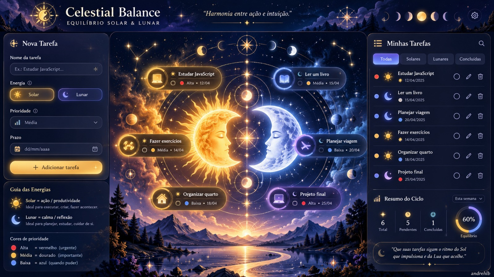

# To-Do List | Descomplica & Venturus

<a href="README.md" aria-current="page"><picture><source media="(prefers-color-scheme: dark)" srcset="docs/assets/navigation/project-pt-active.svg"><source media="(prefers-color-scheme: light)" srcset="docs/assets/navigation/project-pt-active-light.svg"></picture></a><a href="README.en.md"><picture><source media="(prefers-color-scheme: dark)" srcset="docs/assets/navigation/project-en.svg"><source media="(prefers-color-scheme: light)" srcset="docs/assets/navigation/project-en-light.svg"></picture></a> 
<a href="docs/RESPONSABILIDADES.md"><picture><source media="(prefers-color-scheme: dark)" srcset="docs/assets/navigation/team-pt.svg"><source media="(prefers-color-scheme: light)" srcset="docs/assets/navigation/team-pt-light.svg"></picture></a><a href="docs/RESPONSIBILITIES.en.md"><picture><source media="(prefers-color-scheme: dark)" srcset="docs/assets/navigation/team-en.svg"><source media="(prefers-color-scheme: light)" srcset="docs/assets/navigation/team-en-light.svg"></picture></a>

Projeto final da trilha de **Fundamentos de Desenvolvimento Web / Lógica de Programação Web**, desenvolvido em colaboração por **André** e **Paula**.

O projeto é uma aplicação web de gerenciamento de tarefas construída com **HTML, CSS e JavaScript puro**. Seu foco é a manipulação do DOM, o gerenciamento de tarefas, o armazenamento no navegador, a acessibilidade, o design responsivo e as interfaces com temas visuais.

> **Situação do projeto:** em planejamento e desenvolvimento. As funcionalidades abaixo descrevem o escopo acordado, não necessariamente implementações já concluídas.

## Funcionalidades planejadas

- Criar, exibir, editar, concluir e excluir tarefas (CRUD).
- Persistir tarefas localmente no navegador usando `localStorage`.
- Definir prioridades e prazos para as tarefas.
- Pesquisar e filtrar tarefas.
- Exibir progresso e estatísticas das tarefas.
- Alternar entre temas visuais e modos de aparência claro, escuro ou automático.
- Oferecer suporte a português (Brasil) e inglês.
- Proporcionar interações responsivas e acessíveis.

## Temas visuais

Estão planejadas três experiências visuais. Ambos os integrantes implementarão partes definidas de cada tema.

| Tema | André | Paula |
| --- | --- | --- |
| **Orbit & Gravity** | Cenário espacial, estrelas, sol e controles | Coordenação do tema; planetas, órbitas, posicionamento e interações |
| **Sinking Island** | Coordenação do tema; lógica da maré e do progresso das tarefas | Ilha, água, paisagem e transições |
| **Celestial Balance** | Experiência Lunar | Experiência Solar |

## Galeria dos temas

**Conceitos visuais planejados:** estas prévias representam a proposta visual dos temas, não telas já implementadas. No GitHub, clique em uma miniatura para abrir a imagem original em outra aba, mantendo este README aberto.

### Orbit & Gravity

<table>
  <tr><th>Modo claro</th><th>Modo escuro</th></tr>
  <tr>
    <td></td>
    <td></td>
  </tr>
</table>

### Sinking Island

<table>
  <tr><th>Modo claro</th><th>Modo escuro</th></tr>
  <tr>
    <td></td>
    <td></td>
  </tr>
</table>

### Celestial Balance

<table>
  <tr><th>Modo claro</th><th>Modo escuro</th></tr>
  <tr>
    <td></td>
    <td></td>
  </tr>
</table>

## Equipe e responsabilidades

As responsabilidades abaixo refletem a divisão confirmada pelos dois integrantes em suas conversas. Elas descrevem **quem implementa cada parte**, não uma autoridade exclusiva sobre decisões: interfaces compartilhadas, contratos de dados e integrações são revisados em conjunto.

### Fase 1 — Núcleo da aplicação

| André | Paula |
| --- | --- |
| `task-model.js` — criar e validar objetos de tarefa | `storage.js` — camada de dados com operações de criação, consulta, atualização e remoção |
| `eventos.js` — notificar os módulos quando os dados das tarefas mudarem | Renderização da lista de tarefas |
| Cadastro de tarefas e formulário | Marcar tarefas como concluídas |
| Edição de tarefas | |
| Exclusão de tarefas | |

Paula proporá o formato dos dados da tarefa em uma GitHub Issue. **Os dois integrantes devem revisar e aprovar o modelo e os contratos entre módulos antes da implementação.** As funcionalidades da interface utilizam as funções comuns de armazenamento, evitando implementar lógicas de persistência separadas.

### Fase 2 — Funcionalidades adicionais

| André | Paula |
| --- | --- |
| Estatísticas das tarefas e indicadores de progresso | Prioridades das tarefas |
| Prazos e regras de urgência | Pesquisa e filtros |
| Estrutura da página e navegação | Seletor de temas |
| Modos de aparência claro, escuro e automático | Mecanismo de alternância de idiomas |

Cada integrante traduz e testa as funcionalidades que implementar. Acessibilidade, integração, testes, revisão de código e documentação do projeto são responsabilidades compartilhadas.

Para consultar a divisão acordada, as orientações de integração e as GitHub Issues planejadas, veja [Responsabilidades](docs/RESPONSABILIDADES.md) *(rascunho para revisão conjunta)*.

## Tecnologias

- HTML5
- CSS3
- JavaScript puro
- `localStorage` do navegador
- Git e GitHub

O núcleo do projeto não exige framework, API externa ou backend.

## Estrutura do projeto

O repositório parte de uma estrutura mínima de HTML, CSS e JavaScript. Módulos adicionais e estilos específicos dos temas serão criados conforme o trabalho avançar. Os nomes apresentados na seção de responsabilidades refletem os contratos planejados entre módulos.

## Fluxo de colaboração

1. Definir cada funcionalidade e seus critérios de aceite em uma GitHub Issue.
2. Implementar as alterações separadamente, mantendo os commits focados em um assunto.
3. Abrir um Pull Request (PR) para revisão pelo outro integrante.
4. Verificar se a integração funciona antes do merge na `main`.
5. Atualizar a documentação quando uma interface ou responsabilidade acordada mudar.

## Apresentação

O projeto será preparado para uma **apresentação de aproximadamente 10 minutos**, destacando o gerenciador de tarefas em funcionamento, a organização do código e as contribuições dos dois desenvolvedores.

## Integrantes

André e Paula atuam no desenvolvimento, na interface e na documentação.

| Integrante | GitHub | LinkedIn |
| --- | --- | --- |
| André | [@Andrehlb](https://github.com/Andrehlb) | [André](https://www.linkedin.com/in/andrehlb) |
| Paula | [@Paula-Thamyres](https://github.com/Paula-Thamyres) | [Paula](https://www.linkedin.com/in/paula-femina/) |

Ambos compartilham a responsabilidade pelas decisões técnicas e pelo resultado final.
